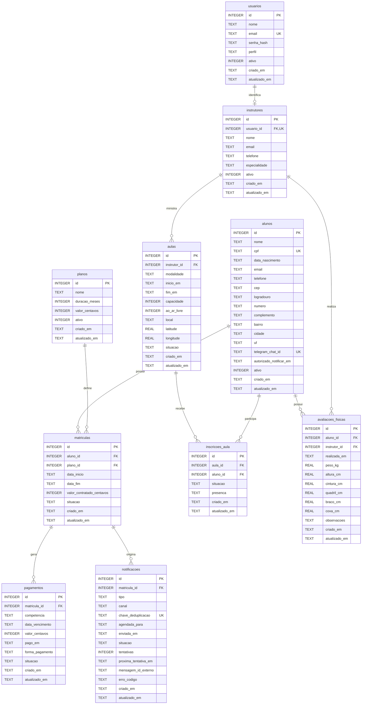

# Arquitetura do sistema de gestão da academia

Documento de arquitetura baseado no `AGENTS.md` e no `README.md`. As decisões monetárias identificadas como aprovadas na seção 2 são regras do projeto. As demais propostas técnicas e questões comerciais pendentes continuam sujeitas à validação do grupo, sem aprovação implícita por este registro.

## 1. Visão geral e limites das camadas

Avisos internos: a [central de avisos](AVISOS.md) usa os marcos de 7, 3 e 0 dias antes do término de matrículas ativas. A migração 004 registra data-alvo, antecedência, leitura e invalidação em notificações. A integração externa permanece para a etapa de mensagens.

Financeiro: a [consulta de inadimplência](INADIMPLENCIA.md) usa as mensalidades da etapa de pagamentos e o dia civil de São Paulo. Admin e recepção podem consultar e abrir a baixa integral.

Matrículas: cadastro, consulta, cancelamento e encerramento foram integrados ao Electron com autorização de admin e recepção. A exclusão física sem pagamentos ou notificações vinculados é exclusiva do admin. O cadastro bloqueia sobreposição inclusiva de matrículas ativas do mesmo aluno, independentemente do plano, em transação de escrita. O encerramento é permitido após o último dia contratado. Ver [MATRICULAS.md](MATRICULAS.md). Regras financeiras continuam pendentes.

Atualização da frente do Davi: CRUD de alunos, ViaCEP e CRUD de planos integrados ao Main/preload/renderer, reutilizando schema e sessões, sem migrations. Regras e testes estão em [ALUNOS.md](ALUNOS.md), [VIACEP.md](VIACEP.md) e [PLANOS.md](PLANOS.md). Planos preservam preço/datas contratados das matrículas, aceitam valor zero e mantêm FK RESTRICT na exclusão. Os trechos históricos abaixo sobre domínios ausentes descrevem o estado anterior a essas entregas. Matrículas continuam para uma etapa posterior.

Aplicação desktop em Electron e TypeScript com `strict`, SQLite com `better-sqlite3`, validação com zod e senhas com Argon2id, conforme decisão autorizada na 4.2 que substitui a previsão inicial de bcrypt. Toda lógica de negócio pertence a classes, uma por arquivo com o mesmo nome. Não haverá arquivos `.js` com lógica da aplicação nem uso de `any`.

Estado atual: CRUD administrativo de usuários integrado em Main/preload/IPC e interface, com login/logout e provisionamento local do primeiro admin em banco vazio. A atualização genérica não aceita senha; usuarios:alterar-senha recebe { id, senha } exclusivamente para redefinição por admin. A migration 003 acrescenta versão de credencial, conferida no login/sessão e antes das escritas; redefinição confirmada revoga credenciais anteriores. Há expiração e limites de tentativas configuráveis. Os demais canais/regras abaixo representam contratos para módulos ainda ausentes; estado verificável em ENCERRAMENTO.md.

Correção 5.2: além das colunas de domínio do diagrama inicial, usuarios possui a coluna técnica identidade_conta (TEXT, não nula, única, gerada pelo SQLite e imutável), adicionada pela migration 2 sem editar a versão 1. Sessões vinculam ID numérico e essa identidade persistente; IDs reutilizados não transferem autenticação. Exclusão confirmada revoga as sessões locais por identidade, e operações pendentes conferem identidade antes de autorizar/gravar. O campo não integra os DTOs ou payloads IPC; não é um token de acesso. Detalhes de atomicidade, testes e limites estão nos documentos de segurança/autenticação.

Correção 5.3: a identidade do alvo administrativo é capturada sincronamente antes do primeiro await, inclusive antes da autorização assíncrona do solicitante. O vínculo interno imutável contém ID e identidade persistente (ou ausência inicial), não vem do renderer e não é recapturado ao retomar a operação. A autorização do admin e a identificação do alvo são garantias distintas; ambas são revalidadas na transação IMMEDIATE da operação. Alvo substituído retorna CONFLITO; alvo ausente inicialmente ou removido retorna NAO_ENCONTRADO. Nenhuma dessas recusas modifica a conta substituta ou revoga suas sessões.

Fluxo de uma operação: **tela → preload → handler IPC → service → repository → SQLite**. Os models representam as entidades usadas pelas camadas. A dependência segue a organização model → repository → service → handler → tela; a tela nunca importa acesso ao banco ou bibliotecas do Node.

Na implementação atual da frente do Miguel, o processo main cria conexão, repositories, services, sessão e handlers de autenticação, usuários e inicialização. O preload expõe métodos específicos e tipados. O renderer recebe apenas DTOs serializáveis, sem hashes, tokens ou objetos de conexão. A API Express e o consumo de relatórios ainda são planejados, sob responsabilidade de Julio: o servidor deverá ficar no mesmo processo proprietário da conexão, escutar apenas em loopback e compartilhar services de consulta. Seu consumo deverá ocorrer por HTTP no main, por meio de `RelatorioService`, preservando o requisito de consumo real da API própria quando essa integração for implementada.

## 2. Modelo relacional

Tipos do diagrama são os tipos de armazenamento do SQLite. `INTEGER` em chaves é identificador inteiro; valores monetários são centavos; booleanos são `INTEGER` limitados a 0 e 1. Datas civis usam `TEXT` no formato `YYYY-MM-DD`; instantes usam `TEXT` ISO 8601 em UTC. Horários são apresentados no fuso configurado da academia. Campos são obrigatórios, exceto os explicitamente listados como anuláveis após o diagrama.



### Integridade e significado dos dados

- `usuarios.perfil`: `admin`, `recepcao` ou `instrutor`; e-mail normalizado e único. `instrutores.usuario_id` é obrigatório e único; o service exige usuário ativo com perfil instrutor. Admin não precisa de cadastro de instrutor para administrar avaliações.
- Anuláveis em alunos: e-mail, telefone, complemento, `telegram_chat_id` e `autorizado_notificar_em`. Em pagamentos: `pago_em` e `forma_pagamento`. Em aulas: latitude e longitude apenas quando internas. Em avaliações: cintura, quadril, braço, coxa e observações. Em notificações: envio, próxima tentativa, identificador externo e código de erro.
- CPF armazena apenas dígitos e deve ser validado. CPF completo só aparece na consulta individual administrativa necessária à edição; listagens usam CPF mascarado. Instrutor recebe projeção sem CPF, contato ou endereço.
- Planos têm duração de 1, 3 ou 12 meses. `valor_contratado_centavos` preserva o preço combinado mesmo após alteração do plano. A matrícula possui intervalo inclusivo válido e situação `ativa`, `cancelada` ou `encerrada`; vencimento é derivado da data final.
- Pagamentos representam cobranças, inclusive antes da quitação: situação `pendente`, `pago` ou `cancelado`. Inadimplência é derivada de cobrança pendente com vencimento anterior à data local atual. `competencia` usa `YYYY-MM`; chave composta única `(matricula_id, competencia)`. Pagamento quitado exige instante de quitação e forma `dinheiro`, `pix`, `cartao` ou `transferencia`.
- Cada aula é uma ocorrência com início e fim, modalidade `musculacao`, `funcional` ou `danca`, capacidade positiva e situação `agendada`, `cancelada` ou `concluida`. Aulas externas exigem coordenadas válidas. Não há recorrência implícita.
- Inscrição tem chave única `(aula_id, aluno_id)`, situação `ativa` ou `cancelada` e presença `nao_registrada`, `presente` ou `ausente`. Presença pertence à inscrição, permitindo relatórios de frequência sem tabela adicional.
- Avaliações usam unidades explícitas, valores positivos e limites plausíveis validados no service. Evolução é a série cronológica de avaliações do aluno.
- Notificações obtêm o aluno pela matrícula, evitando duplicar FK. Tipo inicial `vencimento_plano`, canal `telegram`, situação `pendente`, `processando`, `enviada`, `falhou` ou `cancelada`. A chave de deduplicação combina matrícula, data final, tipo e antecedência configurada.
- A conexão habilita `PRAGMA foreign_keys = ON` antes de qualquer operação. Todas as FKs usam `ON DELETE RESTRICT`; excluir um registro referenciado retorna conflito com mensagem clara. CRUD inclui exclusão física de registros sem dependências; desativar ou cancelar preserva histórico quando existem vínculos. Não há cascata destrutiva.
- Migrations aplicam `NOT NULL`, `UNIQUE`, `CHECK` para enums, valores e coerência de datas, além das FKs. Regras entre tabelas ficam nos services, dentro de transações. Índices cobrem FKs, vencimento de cobranças, fim de matrículas, horário das aulas e `(aluno_id, realizada_em)` nas avaliações.
- Inscrever aluno verifica matrícula válida na data da aula, capacidade e duplicidade dentro de uma transação. Alterações de aula e inscrição preservam capacidade; mudanças no perfil de usuário vinculado a instrutor são bloqueadas enquanto incompatíveis. Não se exclui nem desativa o último admin ativo.

### Decisões monetárias aprovadas

Os valores monetários são armazenados em centavos, com tipo `INTEGER`. Nas três colunas monetárias atuais, valores negativos não são permitidos:

| Tabela e coluna | Regra aprovada |
|---|---|
| `planos.valor_centavos` | Maior ou igual a zero |
| `matriculas.valor_contratado_centavos` | Maior ou igual a zero |
| `pagamentos.valor_centavos` | Maior ou igual a zero |

Valores iguais a zero são permitidos nas três colunas, inclusive para planos gratuitos. Essa permissão não define o fluxo de isenção individual, geração de cobrança zerada ou quitação.

Créditos, descontos, estornos e reembolsos não devem ser representados simplesmente por valores negativos nessas colunas. Caso essas funcionalidades sejam implementadas, deverão possuir operações e registros próprios, preservando o histórico financeiro. Essa diretriz de modelagem está aprovada; não aprova a inclusão dessas funcionalidades no escopo nem define tabelas, campos, cálculos ou fluxos para elas.

### Questões financeiras ainda pendentes

As seguintes questões precisam ser discutidas com o grupo, especialmente Davi Rodrigues e Vitor Meneghin, antes da implementação correspondente:

- Se o preço de planos trimestrais e anuais representa o total do período ou um valor mensal.
- Como serão tratados descontos e isenções individuais.
- Como funcionarão créditos, pagamentos parciais e reembolsos, incluindo o detalhamento de eventuais operações de estorno.
- Como será definido o calendário de cobrança e parcelamento.

Nenhuma dessas pendências é resolvida pela regra de não negatividade ou pela permissão de zero. As constraints já existentes não substituem a aprovação das políticas comerciais.

## 3. Estrutura prevista de src/

A estrutura abaixo preserva o desenho originalmente previsto e reúne componentes já implementados e componentes planejados; não é um inventário exato dos arquivos atuais. Já existem a infraestrutura Electron, conexão e migrations, BaseRepository, autenticação e sessões, provisionamento inicial e CRUD administrativo de usuários com sua ponte e interface. Os módulos de negócio dos colegas, suas integrações e a API de relatórios permanecem planejados. O estado implementado e as validações estão registrados em `ENCERRAMENTO.md`. Subpastas seguem domínio; cada classe fica em arquivo próprio. Arquivos de tipos e schemas exportam contratos e validações, sem funções soltas de negócio.

```text
src/
  main/
    Aplicacao.ts                  inicialização e encerramento
    JanelaPrincipal.ts            BrowserWindow e navegação permitida
    Composicao.ts                 instanciação e injeção das dependências
    ipc/
      RegistroIpc.ts              registro explícito dos canais
      AutenticacaoHandler.ts
      UsuarioHandler.ts
      AlunoHandler.ts
      PlanoHandler.ts
      MatriculaHandler.ts
      PagamentoHandler.ts
      InstrutorHandler.ts
      AulaHandler.ts
      InscricaoAulaHandler.ts
      AvaliacaoFisicaHandler.ts
      NotificacaoHandler.ts
      IntegracaoHandler.ts        CEP e clima
      RelatorioHandler.ts
    seguranca/
      SessaoManager.ts            sessão por webContents
      Autorizador.ts              perfil, origem e escopo do registro
    tarefas/
      AgendadorNotificacoes.ts    agenda e retoma envios pendentes
  preload/
    PonteAcademia.ts              exposição dos métodos permitidos
  renderer/
    index.html
    AplicacaoRenderer.ts
    telas/
      LoginTela.ts
      UsuariosTela.ts
      AlunosTela.ts
      PlanosTela.ts
      MatriculasTela.ts
      PagamentosTela.ts
      InstrutoresTela.ts
      AulasTela.ts
      InscricoesAulaTela.ts
      AvaliacoesFisicasTela.ts
      NotificacoesTela.ts
      RelatoriosTela.ts
    componentes/                 formulários, tabelas e mensagens
    estilos/                     CSS da interface
  models/
    Usuario.ts
    Aluno.ts
    Plano.ts
    Matricula.ts
    Pagamento.ts
    Instrutor.ts
    Aula.ts
    InscricaoAula.ts
    AvaliacaoFisica.ts
    Notificacao.ts
  repositories/
    BaseRepository.ts
    UsuarioRepository.ts
    AlunoRepository.ts
    PlanoRepository.ts
    MatriculaRepository.ts
    PagamentoRepository.ts
    InstrutorRepository.ts
    AulaRepository.ts
    InscricaoAulaRepository.ts
    AvaliacaoFisicaRepository.ts
    NotificacaoRepository.ts
  services/
    AutenticacaoService.ts
    UsuarioService.ts
    AlunoService.ts
    PlanoService.ts
    MatriculaService.ts
    PagamentoService.ts
    InadimplenciaService.ts
    NotificacaoService.ts
    MensagemService.ts
    ViaCepService.ts
    InstrutorService.ts
    AulaService.ts
    InscricaoAulaService.ts
    AvaliacaoFisicaService.ts
    ClimaService.ts
    RelatorioService.ts           cliente HTTP da API própria
    ConsultaRelatorioService.ts   consultas usadas pela API
  api/
    ServidorRelatorios.ts
    RelatorioController.ts
    AutenticacaoApi.ts
  database/
    Conexao.ts
    Migrador.ts
    migrations/
      Migracao001EstruturaInicial.ts
  shared/
    ipc/                         mapa canal → entrada/saída e ponte tipada
    dto/                         projeções, paginação e DTOs de escrita
    schemas/                     schemas zod de entradas e respostas externas
    tipos/                       perfis, enums e resultado discriminado
  config/
    Configuracao.ts               leitura e validação de ambiente no main
```

`BaseRepository<T>` define criar, buscar por ID, listar com paginação, atualizar e excluir. Todos os repositories concretos o estendem e usam SQL parametrizado. Nomes de tabela, coluna e ordenação vêm de constantes internas e listas permitidas, nunca diretamente da entrada. Transações usam a mesma conexão injetada.

## 4. Classes e responsáveis

Cada nome na tabela representa uma classe e seu arquivo `.ts` homônimo. A ausência de model/repository em um serviço auxiliar indica que ele usa entidades existentes.

| Domínio | Models | Repositories | Services | Responsável |
|---|---|---|---|---|
| Base | — | `BaseRepository<T>` | — | Miguel G. |
| Usuários e login | `Usuario` | `UsuarioRepository` | `UsuarioService`, `AutenticacaoService` | Miguel G. |
| Alunos | `Aluno` | `AlunoRepository` | `AlunoService`, `ViaCepService` | Davi Rodrigues |
| Planos | `Plano` | `PlanoRepository` | `PlanoService` | Davi Rodrigues |
| Matrículas | `Matricula` | `MatriculaRepository` | `MatriculaService` | Davi Rodrigues |
| Pagamentos | `Pagamento` | `PagamentoRepository` | `PagamentoService`, `InadimplenciaService` | Vitor Meneghin |
| Notificações | `Notificacao` | `NotificacaoRepository` | `NotificacaoService`, `MensagemService` | Vitor Meneghin |
| Instrutores | `Instrutor` | `InstrutorRepository` | `InstrutorService` | Julio Isidoro |
| Aulas | `Aula` | `AulaRepository` | `AulaService`, `ClimaService` | Julio Isidoro |
| Inscrições | `InscricaoAula` | `InscricaoAulaRepository` | `InscricaoAulaService` | Julio Isidoro |
| Avaliações | `AvaliacaoFisica` | `AvaliacaoFisicaRepository` | `AvaliacaoFisicaService` | Julio Isidoro |
| Relatórios | — | Repositories existentes | `RelatorioService`, `ConsultaRelatorioService` | Julio Isidoro |

Miguel também responde por conexão, migrations, configuração, composição, sessão, autorização, registro IPC e ponte. Cada integrante implementa os handlers, schemas, DTOs e telas de seu domínio seguindo esse contrato. Vitor responde pelo agendador; Julio pelo servidor, controller e autenticação da API, em integração com a segurança de Miguel. Alterações em infraestrutura compartilhada devem ser comunicadas ao responsável antes da edição.

## 5. Contrato IPC

### Convenções comuns

Cada canal listado é independente e usa `invoke/handle`; não existe canal genérico para executar SQL, escolher um método ou fazer HTTP arbitrário. A ponte expõe uma função tipada por canal. O main valida origem do evento, sessão, perfil, escopo e entrada zod em toda chamada. Login exige origem confiável, mas não sessão; o perfil é obtido da sessão e nunca aceito do renderer.

Todas as saídas são envolvidas por `Resultado<T>`: sucesso `{ sucesso: true, dados: T }` ou falha `{ sucesso: false, erro: { codigo, mensagem, campos? } }`. Códigos: `VALIDACAO`, `NAO_AUTENTICADO`, `SEM_PERMISSAO`, `NAO_ENCONTRADO`, `CONFLITO`, `REDE` e `INTERNO`. Mensagens não revelam SQL, stack ou segredos.

`Id` significa `{ id: inteiro positivo }`; `Lista` contém `{ pagina, tamanho, busca? }`, com tamanho entre 1 e 100. `Pagina<T>` contém `{ itens: T[], total, pagina, tamanho }`. Filtros específicos aparecem abaixo. Exclusões retornam `{ id, excluido: true }` somente após efetivação.

`NovoX` contém os campos editáveis definidos na próxima tabela; não aceita ID, timestamps ou campos internos. Atualização contém `{ id, alteracoes: Partial<NovoX> }`, com ao menos um campo. Campos desconhecidos são rejeitados. `XDto` retorna os dados públicos da entidade; nunca inclui `senha_hash`. Listagens de alunos mascaram CPF; projeções do instrutor omitem dados pessoais desnecessários. Para usuário, entrada `senha` é convertida em hash apenas no service e nunca retorna na saída.

| Entrada | Campos editáveis |
|---|---|
| `NovoUsuario` | nome, email, senha, perfil, ativo |
| `NovoAluno` | nome, cpf, data_nascimento, email, telefone, cep, logradouro, numero, complemento, bairro, cidade, uf, telegram_chat_id, autorizado_notificar_em, ativo |
| `NovoPlano` | nome, duracao_meses, valor_centavos, ativo |
| `NovaMatricula` | aluno_id, plano_id, data_inicio, data_fim, valor_contratado_centavos, situacao |
| `NovoPagamento` | matricula_id, competencia, data_vencimento, valor_centavos, pago_em, forma_pagamento, situacao |
| `NovoInstrutor` | usuario_id, nome, email, telefone, especialidade, ativo |
| `NovaAula` | instrutor_id, modalidade, inicio_em, fim_em, capacidade, ao_ar_livre, local, latitude, longitude, situacao |
| `NovaInscricaoAula` | aula_id, aluno_id, situacao, presenca |
| `NovaAvaliacaoFisica` | aluno_id, instrutor_id, realizada_em, peso_kg, altura_cm, cintura_cm, quadril_cm, braco_cm, coxa_cm, observacoes |
| `NovaNotificacao` | matricula_id, agendada_para; tipo e canal fixados pelo service |

### Canais de CRUD

A = admin; R = recepcao; I = instrutor. As restrições de escopo da seção 6 também se aplicam aqui.

| Canal | Entrada | Dados de sucesso | Perfis |
|---|---|---|---|
| `usuarios:criar` | NovoUsuario | UsuarioDto | A |
| `usuarios:listar` | Lista | Pagina<UsuarioDto> | A |
| `usuarios:obter` | Id | UsuarioDto | A |
| `usuarios:atualizar` | id, alteracoes | UsuarioDto | A |
| `usuarios:excluir` | Id | id, excluido | A |
| `alunos:criar` | NovoAluno | AlunoDto | A, R |
| `alunos:listar` | Lista | Pagina<AlunoResumoDto> | A, R, I |
| `alunos:obter` | Id | AlunoDto ou AlunoInstrutorDto conforme perfil | A, R, I |
| `alunos:atualizar` | id, alteracoes | AlunoDto | A, R |
| `alunos:excluir` | Id | id, excluido | A |
| `planos:criar` | NovoPlano | PlanoDto | A |
| `planos:listar` | Lista | Pagina<PlanoDto> | A, R |
| `planos:obter` | Id | PlanoDto | A, R |
| `planos:atualizar` | id, alteracoes | PlanoDto | A |
| `planos:excluir` | Id | id, excluido | A |
| `matriculas:criar` | NovaMatricula | MatriculaDto | A, R |
| `matriculas:listar` | Lista, aluno_id?, situacao? | Pagina<MatriculaDto> | A, R |
| `matriculas:obter` | Id | MatriculaDto | A, R |
| `matriculas:atualizar` | id, alteracoes | MatriculaDto | A, R |
| `matriculas:excluir` | Id | id, excluido | A |
| `pagamentos:criar` | NovoPagamento | PagamentoDto | A, R |
| `pagamentos:listar` | Lista, matricula_id?, situacao? | Pagina<PagamentoDto> | A, R |
| `pagamentos:obter` | Id | PagamentoDto | A, R |
| `pagamentos:atualizar` | id, alteracoes | PagamentoDto | A, R |
| `pagamentos:excluir` | Id | id, excluido | A |
| `instrutores:criar` | NovoInstrutor | InstrutorDto | A |
| `instrutores:listar` | Lista | Pagina<InstrutorDto> | A, R, I |
| `instrutores:obter` | Id | InstrutorDto | A, R, I |
| `instrutores:atualizar` | id, alteracoes | InstrutorDto | A |
| `instrutores:excluir` | Id | id, excluido | A |
| `aulas:criar` | NovaAula | AulaDto | A, I |
| `aulas:listar` | Lista, inicio?, fim?, instrutor_id? | Pagina<AulaDto> | A, R, I |
| `aulas:obter` | Id | AulaDto | A, R, I |
| `aulas:atualizar` | id, alteracoes | AulaDto | A, I |
| `aulas:excluir` | Id | id, excluido | A, I |
| `inscricoes-aula:criar` | NovaInscricaoAula | InscricaoAulaDto | A, R, I |
| `inscricoes-aula:listar` | Lista, aula_id?, aluno_id? | Pagina<InscricaoAulaDto> | A, R, I |
| `inscricoes-aula:obter` | Id | InscricaoAulaDto | A, R, I |
| `inscricoes-aula:atualizar` | id, alteracoes | InscricaoAulaDto | A, R, I |
| `inscricoes-aula:excluir` | Id | id, excluido | A, R, I |
| `avaliacoes-fisicas:criar` | NovaAvaliacaoFisica | AvaliacaoFisicaDto | A, I |
| `avaliacoes-fisicas:listar` | Lista, aluno_id?, inicio?, fim? | Pagina<AvaliacaoFisicaDto> | A, I |
| `avaliacoes-fisicas:obter` | Id | AvaliacaoFisicaDto | A, I |
| `avaliacoes-fisicas:atualizar` | id, alteracoes | AvaliacaoFisicaDto | A, I |
| `avaliacoes-fisicas:excluir` | Id | id, excluido | A, I |
| `notificacoes:criar` | NovaNotificacao | NotificacaoDto | A, R |
| `notificacoes:listar` | Lista, matricula_id?, situacao? | Pagina<NotificacaoDto> | A, R |
| `notificacoes:obter` | Id | NotificacaoDto | A, R |
| `notificacoes:atualizar` | id, alteracoes: { agendada_para?, situacao?: pendente ou cancelada } | NotificacaoDto | A, R |
| `notificacoes:excluir` | Id | id, excluido | A |

Notificações enviadas ou em processamento não podem ser reagendadas ou editadas; exclusão em processamento retorna conflito. Tentativas, destino, texto, identificador externo e deduplicação são gerenciados pelo service. Atualização de inscrição por instrutor exige a mesma aula de sua responsabilidade e não permite transferir aluno ou aula.

### Autenticação, integrações e relatórios

| Canal | Entrada | Dados de sucesso | Perfis |
|---|---|---|---|
| `auth:entrar` | email, senha | usuario: { id, nome, perfil } | Sem sessão; origem validada |
| `auth:sessao` | vazio | usuario: { id, nome, perfil } | A, R, I |
| `auth:sair` | vazio | encerrada: true | A, R, I |
| `endereco:consultar-cep` | cep com 8 dígitos | cep, logradouro, bairro, cidade, uf | A, R |
| `clima:consultar-aula` | aula_id | inicio_em, probabilidade_chuva, precipitacao_mm, alerta, consultado_em | A, R, I |
| `pagamentos:inadimplentes` | Lista, data_referencia | Pagina<{ aluno_id, nome, quantidade_atrasada, total_centavos }> | A, R |
| `notificacoes:reenviar` | Id | NotificacaoDto com reenvio agendado | A, R |
| `relatorios:evolucao` | aluno_id, inicio, fim | aluno_id, pontos: [{ realizada_em, peso_kg, altura_cm, cintura_cm, quadril_cm, braco_cm, coxa_cm }] | A, I |
| `relatorios:frequencia` | inicio, fim, aluno_id?, aula_id? | itens: [{ aluno_id, nome, presentes, ausentes, nao_registradas, percentual_presenca }] | A, R, I |

O percentual usa apenas presenças registradas de inscrições ativas em aulas concluídas: presentes / (presentes + ausentes) × 100; sem registros, retorna `null`. Relatórios limitam intervalo e volume; não retornam histórico ilimitado. Respostas meteorológicas ausentes são erro de disponibilidade, nunca interpretadas como ausência de chuva.

## 6. Permissões por perfil

C = criar; L = ler (listar e obter); U = atualizar; E = excluir. `—` significa nenhum acesso. A matriz é uma proposta de menor privilégio para a implementação, sujeita à validação do grupo.

| Entidade | admin | recepcao | instrutor |
|---|---|---|---|
| usuarios | C, L, U, E | — | — |
| alunos | C, L, U, E | C, L, U | L com projeção restrita |
| planos | C, L, U, E | L | — |
| matriculas | C, L, U, E | C, L, U | — |
| pagamentos | C, L, U, E | C, L, U | — |
| instrutores | C, L, U, E | L | L do próprio cadastro |
| aulas | C, L, U, E | L | C, L, U, E das próprias aulas |
| inscricoes_aula | C, L, U, E | C, L, U, E | C, L, U, E das próprias aulas |
| avaliacoes_fisicas | C, L, U, E | — | C, L, U, E com escopo abaixo |
| notificacoes | C, L, U, E | C, L, U | — |

Instrutores consultam alunos vinculados às suas aulas ou às avaliações que realizaram. Criam avaliações apenas para alunos desse conjunto e com `instrutor_id` correspondente à sessão; leem o histórico desses alunos para acompanhar evolução; alteram e excluem somente avaliações de sua autoria. Relatórios de frequência para instrutor abrangem apenas suas aulas; evolução exige o mesmo escopo de leitura das avaliações. A verificação usa os vínculos reais no main e também na API, incluindo IDs anteriores e novos em atualizações. O renderer não determina o escopo.

O contrato prevê CRUD completo para as dez entidades, com ao menos admin autorizado em cada operação. Isso não significa que os dez módulos estejam implementados. Na etapa 5, somente o CRUD administrativo de usuários foi integrado; os outros domínios dependem dos respectivos integrantes. Restrições de integridade continuam valendo para admin. Exclusão de cobrança paga ou notificação enviada exige política de retenção definida antes da implementação; a existência do canal não dispensa essa verificação.

## 7. Quatro consumos de API

Os contratos abaixo descrevem a integração planejada; detalhes de provedores devem ser conferidos na documentação oficial durante a implementação. Todas as chamadas saem de services no main, têm timeout, validação zod da resposta, mensagens claras e logs sem dados sensíveis. O renderer não escolhe URLs.

| API | Classe / responsável | Entrada e saída usadas | Finalidade |
|---|---|---|---|
| ViaCEP | `ViaCepService` / Davi | CEP → logradouro, bairro, localidade e UF | Preencher endereço do aluno sem impedir correção manual |
| Open-Meteo | `ClimaService` / Julio | Coordenadas e horário da aula → probabilidade de precipitação e precipitação horária | Alertar sobre chuva em aula externa |
| Telegram Bot API (escolha proposta) | `MensagemService` / Vitor | Chat autorizado e mensagem de vencimento → confirmação e ID externo | Avisar que o plano está perto de vencer |
| API própria Express | `RelatorioService` e `ConsultaRelatorioService` / Julio | Filtros de aluno e período → evolução física ou frequência | Demonstrar consulta HTTP real a relatórios do sistema |

### ViaCEP

Consulta HTTPS a `https://viacep.com.br/ws/{cep}/json/`, apenas após validar os oito dígitos. Mapear `localidade` para cidade; tratar CEP inexistente, resposta inválida, indisponibilidade e timeout. Não transmitir nome ou CPF. O retorno é sugestão para o formulário; cadastro permite endereço manual quando o serviço falhar. Não precisa de token.

### Open-Meteo

Consulta HTTPS à API de previsão em `https://api.open-meteo.com/v1/forecast`, usando latitude e longitude cadastradas na aula e variáveis horárias `precipitation_probability` e `precipitation`. Comparar os intervalos da previsão com a ocorrência da aula no fuso correto. O service consulta apenas aulas externas, mantém cache curto por coordenadas e período e retorna o instante da consulta. Fora do horizonte de previsão, informar indisponibilidade. Limiar de alerta é configurável; o sistema informa risco e não cancela aula automaticamente. Não envia dados dos alunos.

### Telegram e vencimento

Usar método `sendMessage` da Telegram Bot API, com token exclusivamente no `.env`. O aluno precisa iniciar contato com o bot e autorizar o recebimento; o chat é cadastrado por fluxo validado, sem envio experimental a destinatários desconhecidos. A mensagem informa apenas nome e data de vencimento, sem CPF ou dados de saúde.

O agendador verifica matrículas ativas cuja data final esteja dentro da antecedência configurada. Cria uma notificação com chave única, respeita autorização e destino disponível e registra tentativas, confirmação e falha sanitizada. Reenvio manual só aceita falhas elegíveis; novas tentativas usam espera progressiva e limite, respeitando limites do provedor. A reserva transacional de pendências impede dois envios concorrentes. Se o provedor aceitar a mensagem e a aplicação cair antes de registrar o sucesso, ainda pode haver duplicação: não se promete entrega exatamente uma vez.

O agendamento funciona enquanto o desktop estiver aberto. Ao iniciar, retoma pendências válidas; execução com aplicativo fechado exigiria serviço externo, fora da arquitetura inicial. Revogação de autorização cancela pendências. Prazos e frequência de tentativas precisam ser definidos pelo grupo.

### API própria de relatórios

Servidor Express iniciado e encerrado pelo main, ligado a `127.0.0.1` em porta configurada ou atribuída pelo sistema. `RelatorioService` consome por HTTP os endpoints; `RelatorioController` valida parâmetros, autentica e delega a `ConsultaRelatorioService`. Este consulta repositories e não chama o cliente HTTP, evitando ciclo.

| Método e rota | Query | Resposta de sucesso | Perfis |
|---|---|---|---|
| `GET /relatorios/evolucao` | aluno_id, inicio, fim | Mesmo DTO de `relatorios:evolucao` | admin, instrutor |
| `GET /relatorios/frequencia` | inicio, fim, aluno_id?, aula_id? | Mesmo DTO de `relatorios:frequencia` | admin, recepcao, instrutor |

Usar credencial aleatória de curta duração associada à sessão, mantida apenas no main e enviada no cabeçalho Authorization. O servidor resolve identidade e perfil por essa credencial, nunca por query ou cabeçalho de perfil fornecido pelo cliente. Logout revoga a credencial; usuário desativado perde acesso. Não basta estar em localhost para acessar dados. CORS não é mecanismo de autenticação. Erros HTTP usam 400, 401, 403, 404 e 500 com mensagens sanitizadas; ausência de pontos no período retorna lista vazia. Limites de período e quantidade são validados também no servidor. Falha na API mantém o restante da aplicação disponível e apresenta erro de relatório, sem contornar silenciosamente o HTTP.

## 8. Segurança e operação

- Electron: `contextIsolation: true`, `nodeIntegration: false`, sandbox habilitado, política de conteúdo restritiva, bloqueio de navegação e janelas inesperadas. Validar remetente e frame em cada IPC; só a janela autorizada pode usar a ponte.
- Senhas: hash Argon2id (decisão da 4.2), comparação no main, nenhum log de senha ou hash; erros de login não revelam existência de usuário. Há um login pendente por contexto, limites temporais por janela/processo e teto global de quatro operações Argon2id. O primeiro admin é provisionado uma única vez em banco vazio; não existe credencial padrão embutida. Novas senhas exigem 15 caracteres Unicode; login preserva compatibilidade com credenciais anteriores.
- Sessão: memória no main, vinculada ao `webContents`, invalidada no logout e encerramento da janela; conferir identidade persistente da conta, usuário ativo e perfil atual em cada operação. Exclusão administrativa revoga sessões locais da identidade após commit; outra conexão é detectada na próxima leitura de autorização, mesmo com reutilização do ID numérico. Não há broadcast nem cancelamento retroativo de operações já confirmadas. O renderer não recebe token da API.
- Validação: todo método público de service valida entradas com zod, inclusive chamadas do agendador e da API. DTOs e schemas distinguem leitura de escrita; entradas não podem alterar campos internos.
- Persistência: SQLite no diretório de dados do usuário do Electron, fora do repositório. FKs e transações protegem consistência. Erros de banco, rede e API são capturados nos limites das operações; logs usam códigos e identificadores mínimos, sem CPF, avaliações, texto de mensagens ou URLs com token.
- LGPD: restringir dados de saúde a admin e instrutor, minimizar projeções, registrar autorização de comunicação e definir retenção e exclusão. SQLite não oferece criptografia de dados automaticamente; proteção de acesso ao sistema operacional e dos backups é necessária. A justificativa completa será documentada em `SEGURANCA.md` na frente de Miguel.
- Ambiente: `.env` ignorado pelo Git; `.env.example` conterá apenas nomes e exemplos fictícios para token do Telegram, porta/fuso, antecedência e limiar de chuva. Token de autenticação da API local é gerado em runtime. Nenhum segredo chega ao renderer ou ao pacote público.
- Ciclo de vida: executar migrations antes de abrir telas; falha de migration interrompe inicialização com orientação clara. Encerramento para agendador, finaliza servidor e fecha conexão. Não bloquear a interface com chamadas de rede; monitorar duração das consultas síncronas ao SQLite.

## 9. Decisões a validar e sequência de implementação

Antes das respectivas funcionalidades, validar com o grupo: Telegram ou e-mail como provedor definitivo; antecedência do aviso; limiar de chuva; calendário de cobrança e parcelamento de planos trimestrais/anuais; sobreposição de matrículas; política de retenção e correção de pagamentos quitados; e a matriz proposta de permissões. A expiração de sessões já está implementada no Main e testada por `test:politicas`: os padrões são 30 minutos de inatividade e oito horas de duração absoluta, configuráveis por `SESSAO_INATIVIDADE_MS` e `SESSAO_DURACAO_MAXIMA_MS`. O uso não prolonga o prazo absoluto. Eventuais ajustes desses parâmetros às necessidades da academia dependem de alinhamento com o grupo; não representam ausência do mecanismo técnico de expiração. Não presumir desconto, multa, bloqueio automático por inadimplência ou cancelamento por chuva.

As decisões monetárias aprovadas e as questões financeiras ainda pendentes estão separadas na seção 2. A não negatividade e a permissão de valores zero estão aprovadas; a interpretação do preço por período, descontos/isenções individuais, créditos, pagamentos parciais, reembolsos e calendário de cobrança continuam pendentes de discussão com Davi e Vitor.

A implementação deve avançar em entregas pequenas: Miguel estabelece infraestrutura, migrations e autenticação; em seguida cada integrante entrega um CRUD completo de seu domínio, com autorização e validação; depois entram integrações e relatórios. Davi e Vitor precisam alinhar geração das cobranças da matrícula em uma única transação quando a política comercial for definida. Não adicionar dependências além da stack sem justificativa.

Verificações previstas: integridade das FKs e exclusão restrita; CRUD das dez entidades; rejeição de perfil indevido em todos os canais; escopo de instrutor; mascaramento e ausência de segredos nos DTOs; capacidade de aula sob concorrência; indisponibilidade das APIs; duplicidade e retomada de notificações; autenticação e escopo dos relatórios HTTP. Estas verificações orientam testes futuros; nenhum teste de aplicação é executável nesta etapa documental.

Trabalho em branch por funcionalidade, commits pequenos com identidade do próprio integrante e revisão do diff antes de commit. Integração à main por Pull Request revisado por outro integrante.
